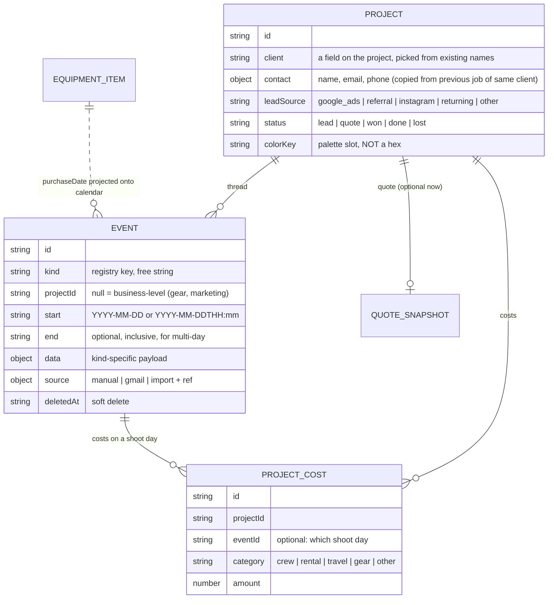

# Plan: Calendar & Project Threads

> Follows [PLAN-V3-PROJECT-HUB.md](PLAN-V3-PROJECT-HUB.md) (phases 0–3 done, phase 4 Finance in progress
> by a separate agent). Source: M.J. brainstorm, 2026-10-08.
> Track numbers here are **T1–T8** so they don't collide with the v3 phase numbers.

---

## 1. The idea in one paragraph

Every job is a **thread**: lead email → reply → quote sent → accepted → shoot days → post-production
→ deadline → invoice sent → invoice paid. Each step is a **dated event**. The **Calendar** is the
place where you see and add those events across all projects. Every other part of the app (project
page, Finance, Gear, marketing stats) **reads the same events** instead of keeping its own dates.
Store dated facts once. Every statistic ("how fast did I reply", "how long until I got paid", "how
many post days did this take", "how much gear did I buy this month") is *computed* from them, never
stored.

---

## 2. What you described, sorted

| Area | Wants | Lands in |
|---|---|---|
| Calendar | Separate tab, full month view, click a day → add typed event (iOS-style), easy editing, retrofill all of 2026 | T2 |
| Event types | Lead in, reply, quote sent, won/lost, shoot days, post-production days, deadlines, invoice sent, invoice paid, gear purchase | T1 |
| Colour | Tile colour = project; small marker + short label = event type (e.g. Tchibo: yellow tile, pink "mail" marker on 9 Oct, orange "zdjęcia" marker on 28 Oct) | T2 + design pass |
| Lead tracking | Source, response time, lead progression (new → advanced → won/lost), editable later | T3 |
| Thread → quote | Quote picks up the thread; client details from the lead prefill the quote | T3 |
| Gmail | Pull dates/details from emails, ideally AI-filled | T4 (import) → T8 (in-app) |
| Shoot / Realizacja | Own project tab: crew, gear, actual costs per shoot day; Profit tab moves here out of the calculator; call sheet planner attaches here | T5 |
| Money loop | Quote = planned revenue; real costs + invoice = actual; days-to-payment stat | T6 |
| Insights | Response time, conversion, effort per project for future estimating, gear spend per month, marketing / Google Ads performance | T7 |
| Design | Proper palette from a design pass, readable in dense month view | before T2 |

---

## 3. Data architecture (most of the work is here)

### 3.1 Entities



### 3.2 The event record

```ts
// lib/event-types.ts (sketch)
eventSchema = z.object({
  id:        z.string().min(1),
  kind:      z.string(),                 // NOT z.enum: unknown kinds must survive
  projectId: z.string().nullable().catch(null),
  start:     z.string(),                 // 'YYYY-MM-DD' or 'YYYY-MM-DDTHH:mm' (time optional)
  end:       z.string().optional(),      // inclusive; shoot/post ranges
  title:     z.string().catch(''),
  notes:     z.string().catch(''),
  data:      z.record(z.unknown()).catch({}),   // validated per kind, never stripped
  source:    z.object({ type: z.string(), ref: z.string().optional() }).passthrough()
               .catch({ type: 'manual' }),      // gmail → ref = message/thread id (dedupe)
  createdAt: z.string().catch(''),
  updatedAt: z.string().catch(''),
  deletedAt: z.string().optional(),
}).passthrough()
```

Stored in `events.json` through the existing `createCollectionStore` (Tauri AppData / localStorage).

### 3.2a Client is a field on the project, not a separate record *(decided 2026-10-08)*

There is no clients file. The client is a property of the project, like the status. To avoid the
usual problem with free text ("Tchibo" / "Tchibo Polska" / "tchibo" counting as three clients):

- The client input is a **picker over names already used**, with free typing for a new client.
- Grouping uses a normalised key (trimmed, case- and diacritic-insensitive), so small spelling
  differences still group together. A "merge names" action (built in T10 on the client page, §6d)
  fixes real duplicates by rewriting the field on the affected projects.
- Picking an existing client **copies contact details** from that client's most recent project, so
  repeat clients still prefill the lead and the quote.
- "How much did this client bring in" = filter the projects by client and sum their financials. That
  is a pure function, like every other stat.
- If we ever need real client records, they can be built from these names in one pass without
  losing anything.

### 3.3 Kind registry (code, not data)

`lib/event-kinds.ts`: one entry per kind:

| key | group | range? | payload (`data`) | side effect |
|---|---|---|---|---|
| `lead_in` | sprzedaż | no | channel, contact, first message summary | creates project as `lead` |
| `reply_sent` | sprzedaż | no | — | (feeds response-time stat) |
| `quote_sent` | sprzedaż | no | amount netto snapshot, quote version | suggests status `quote` |
| `follow_up` | sprzedaż | no | — | |
| `won` / `lost` | sprzedaż | no | reason (lost) | suggests status `won` / `lost` |
| `prep_day` | produkcja | yes | recce / meeting | |
| `shoot_day` | produkcja | yes | call sheet id, location | anchors crew/gear/costs |
| `post_day` | postprodukcja | yes | hours (optional) | effort stat |
| `deadline` | postprodukcja | no | what is due | |
| `invoice_sent` | pieniądze | no | number, amount netto, due date | |
| `invoice_paid` | pieniądze | no | amount received | suggests status `done` |
| `extra_sale` | pieniądze | no | what, amount netto, invoice number (T6, §6e) | |
| `gear_purchase` | firma | no | (projected from catalogue `purchaseDate`) | |
| `marketing` | firma | yes | campaign, spend | |
| `note` | inne | yes | — | |

Each kind has: label, group, colour **token**, which fields its add-form shows, a Zod schema for
`data` (all `.catch()`), and an optional "suggest status" effect. Suggestions are always confirmed by
you; the app never changes a project status silently.

### 3.4 Rules that make it safe to change our minds

These rules let us use it for a few weeks, decide it's wrong, and change it without losing data.

1. **Facts stored, stats derived.** "Days to payment" is never saved; it's `invoice_paid − invoice_sent`
   computed by a pure function. New or changed stats never need a data migration.
2. **Every date lives in exactly one place.** Gear purchases stay on the catalogue item
   (`purchaseDate`) and are *projected* onto the calendar. They are not copied into events.
3. **Kind keys are permanent; everything about them is cosmetic.** Labels, colours, groups and form
   fields can change freely. A key is never renamed. If two kinds merge, add an alias map in the
   registry and leave the data alone.
4. **Unknown is kept, not dropped.** `kind` is a free string, `data` is an open record, schemas use
   `.passthrough()`. An older build opening newer data shows an unknown kind as a grey "inne" tile
   and writes it back untouched. (We already got bitten by `z.object` stripping keys:
   `migratedFromQuoteId`. New schemas must default to passthrough.)
5. **Additive changes only by default.** New field = optional + `.catch(default)`. No version bump.
   A real breaking change bumps `version` and gets a migrator with backup-or-abort, using the
   pattern that already exists in `project-migration.ts`.
6. **Soft delete.** `deletedAt` instead of removing. Gmail re-imports stay idempotent (a deleted
   suggestion doesn't come back) and mistakes can be undone.
7. **Colours are palette slots, not hex.** `Project.colorKey = 'amber'`. The palette can be
   redesigned at any time without touching data.
8. **Imports go through review.** Gmail/AI produce *proposed* events; nothing lands without your
   accept. `source.ref` (Gmail message id) dedupes.

### 3.5 Changes to existing models (all additive)

- ~~`Project.status` gains `lead`~~ — **reverted 2026-10-08**: a lead is the `lead_in` *event*, not a
  project status. A project without a quote has status `quote` and shows „brak wyceny"; the funnel
  (inquiries → quotes → jobs) is derived from events. A stored `lead` reads as `quote` via `.catch`.
- `Project.quote` becomes **optional**: a lead has no quote yet. The calculator bridge
  (`project-hub-context.tsx`) opens an empty calculator when there's none. ⚠️ This touches the bridge.
- `Project.client` stays a string (now with a picker); new optional `Project.contact` and
  `Project.leadSource`. No clients file (§3.2a).
- `Project.colorKey`, auto-assigned round-robin from the palette, changeable.
- `Project.date` (ledger date) stays manual for now. Later it can default from events (e.g. first
  shoot day or invoice date).

---

## 4. Screens

**Navigation:** **Kalendarz** (new landing tab) · Projekty · Finanse · Sprzęt · Ustawienia.
Projects stays a clean list for when you only want to look at jobs.

**Kalendarz**
- Full month grid, week rows. Multi-day events (shoot, post) render as bars across days.
- Each item: **tile tinted with the project colour**, plus a **small solid marker in the event-type
  colour with a 1–2 word label** ("mail", "zdjęcia", "FV"). The type is also written as text, so you
  don't have to rely on colour alone.
- Business-level items (gear purchase, marketing) use a neutral tile with only the type marker.
- Click a day → sheet: pick type → type-specific fields → pick project (or "nowy lead" creates one).
  Click an item → edit. Drag to move/resize (later).
- Layer toggles per type group (sprzedaż / produkcja / post / pieniądze / firma) and a project
  filter, so a busy month can be thinned out.
- Month summary strip: leads in, shoot days, post days, invoiced, paid, gear spend.

**Projekty (list)** *(revised with M.J. 2026-10-08)*:
- Filters stay **Wszystko / Tylko projekty / Tylko wyceny**, plus a **„Ukryj nieprzyjęte"** checkbox,
  on by default and remembered; it shows how many are hidden. ✅
- When lost quotes are shown, their amounts are grey — they don't count toward results. ✅
- „Projekty" in the sidebar always returns to the list, also from an open project. ✅
- Client filter (picker) with that client's revenue, and a year filter; both remembered. ✅ (T3)

**Project page tabs**: `Oś czasu · Klient/Lead · Wycena · Realizacja · Notatki`
- *Oś czasu*: the thread as a vertical timeline, with derived numbers inline ("odpowiedź po 6 h",
  "zapłacono po 23 dniach").
- *Wycena*: today's calculator, prefilled with client data from the lead.
- *Realizacja*: shoot days from events; per day: crew, gear (today's Sprzęt tab moves in here),
  actual costs. The current **Profit** tab moves out of the calculator to here as "planned vs actual".
  The call sheet planner (old phase 5) attaches to a shoot day here.

---

## 5. Gmail + AI: is it doable?

Yes, and there are two ways. Start with the cheap one; the second reuses all of it.

**A. Now: Claude Code session as the importer (no new infrastructure).**
This session already has a working Gmail connection. I search your mail for client threads, extract
dates and details (lead received, your reply time, quote sent, acceptance, invoice mails), and write
a `proposed-events.json` file in an agreed format. The app gets a **review queue**: accept / edit /
reject each proposed event, matched to a project or creating one. This is how we retrofill 2026.
Afterwards you can say "sync my mail" every week or two.

**B. Later: in the app itself.**
Google OAuth from the Tauri app (a Google Cloud project you own, `gmail.readonly`, fine for personal
use with some one-off setup friction), plus a Claude API call that turns a thread into the same
proposed-event format. Needs an Anthropic API key stored in the macOS keychain. The cost per thread
is negligible.

The **import format + review queue** is the shared part, so A isn't throwaway work. It is also why
rule 8 exists: the AI suggests, you confirm.

Google Ads works the same way: start with manual monthly spend (already exists as a `FixedCost` of
type `marketing`) plus `lead source`. That alone gives cost per lead and cost per won job. API import
can come later.

---

## 5a. Claude ↔ desktop app data bridge *(decided 2026-10-08)*

Gmail work and data cleanup stay **in the chat with Claude Code**. There's no AI inside the app.
Claude writes to the **same local files the desktop app reads**, so when you open the app from the
Dock the data is already there. You don't need to look at the preview for this.

- **Where:** `~/Library/Application Support/com.michal.quotegen/` (today: `quotes.json`,
  `settings.json`; v3 adds `projects.json`, `equipment.json`, `finances.json`, `events.json`).
  The browser preview uses separate localStorage and is only for testing the UI, never real data.
- **Lane 1 — inbox (anything Gmail-derived):** Claude writes `inbox/*.json` with *proposed* events and
  project changes. The app shows them in the review queue; accepting writes them into the real files.
  You stay the one who confirms. Built in T4, see §5d.
- **Lane 2 — direct edits (only when you ask in chat):** cleanups like "merge these client names" or
  "fix the 2026 shoot dates". Claude edits the real files directly, making a timestamped backup first.
- **No hand-written JSON.** Claude writes through a repo script (`npm run data -- …`) that uses the
  app's own Zod schemas, so a malformed record is rejected loudly instead of silently skipped by the
  app's defensive parser.
- **App picks up changes:** reload collections when the window regains focus (small addition). Saving a
  single record already re-reads the file before writing, so it won't overwrite what Claude added.
  Bulk writes (`replaceAll`, e.g. migration) must do the same before T4 ships.
- **Prerequisite:** a desktop build of the new app (see §5b).

## 5b. New app alongside the old one *(decided 2026-10-08)*

The hub ships as a **separate desktop app**, not an update of QuoteGen. The old QuoteGen
(`com.michal.quotegen`, "NonoiseMedia QG") stays installed and working for real-life quoting until
the hub has earned its place.

- **Own identity:** new Tauri `identifier` (e.g. `com.michal.nonoise-hub`) and `productName`, which
  gives it its **own data folder** and its own Dock icon. The two apps never write to each other's files.
- **Quotes come in read-only:** the hub's migration *reads* the old app's
  `~/Library/Application Support/com.michal.quotegen/quotes.json` and never writes there. This needs
  a read-only filesystem permission for that one path in the hub's Tauri capabilities. The existing
  backup-before-migrate rule stays.
- **Re-import is safe:** quotes you keep making in the old app can be pulled in again later.
  `migratedFromQuoteId` already makes this idempotent, so nothing gets duplicated.
- **Same repo for now:** both apps build from this codebase (the old one from `master`, the hub from
  `v3/project-hub`). Whether the hub gets its own repo or app folder can be decided when it ships;
  it isn't needed to keep developing.
- The Claude bridge (§5a) targets the **hub's** folder only.

**Done 2026-10-08:** "NonoiseMedia Hub", identifier `com.michal.nonoisehub`, v0.3.0, own icon (logo on a
dark tile, source `src-tauri/app-icon-hub.png`). Capabilities allow reading exactly
`$DATA/com.michal.quotegen/quotes.json` and **deny** every write/mkdir under `$DATA/com.michal.quotegen`
(also via the broad `$HOME/**` PDF-export permission). `listImportableQuotes()` (`lib/legacy-app.ts`)
merges the old library with the hub's own (`mergeQuoteSources`, newer copy wins), so the migration
banner can be re-run any time. Settings the old app kept only in WebView storage (portfolio catalogue,
"my default" pricing, current pricing) were carried over once: Claude read them from the old app's
WebKit LocalStorage (a copy) and wrote `carryover-from-quotegen.json` to the hub folder, plus a copy of
`settings.json`; `applyCarryOver()` applies known keys once at start-up and never overwrites.

## 5d. Skrzynka — proposals from mail *(T4 2026-10-09, T4b 2026-10-10)*

Everything that comes from mail enters the app as a **proposal** you accept. Nothing Gmail-derived
is written straight into the data files.

**Format** (`lib/inbox-types.ts`, `format: "nonoise-hub-inbox"`, `version: 1`, passthrough everywhere).
One file per sync in `<hub folder>/inbox/`, named `<local time>-<slug>.json` so name order = time order.
Optional header `sync: { source, from, to, queries? }` records the mailbox window the file covers
(T4b). Four proposal types:

| `type` | Means | Accepting does |
|---|---|---|
| `event` | a new thread event (lead, reply, quote sent, won, shoot day, invoice sent/paid…) with `kind`, `start`, `end?`, `title`, `notes`, `data` | `saveEvent` with `source: { type: 'gmail', ref, threadId, inboxFile }` |
| `event_update` (T4b) | change an **existing** event by `eventId`: `set.linkProject` (to the group's project; `projectId` is the hint), `set.time` (`HH:mm` added to `start`, the day never changes), `set.data` (fields checked by the kind's schema). `ifMissing` (default): only an unlinked event gets a project, only a missing time or empty field is filled. Never kind, day, title, status or deletion | `saveEvent` on the stored event: unknown fields and the original `source` stay, a trace `{ type, ref, threadId, inboxFile, at, fields }` is appended to `updatedFrom[]`; a no-op only records the decision |
| `project_update` | fill `contact` / `leadSource` / `client` on a project; `ifMissing` (default) fills only empty fields, contact field by field | `updateProject` (a no-op is still recorded as accepted) |
| `project_new` | a new quote-less project (`name`, `client`, `date`, `leadSource`, `contact`) | `createProjectWithoutQuote`; with an existing project chosen instead it fills that project's empty fields |

Every proposal has a `ref` = **dedupe key**: `gmail:<message id>`, with a `#fact` suffix when one message
gives several facts (`#contact`, `#project`, `#shoot`). Hints for grouping and matching: `threadId`,
`client`, `email`; `reason` (one sentence, why) and `evidence` (`from`, `to`, `subject`, `date` with the
local offset, `snippet`) for the preview. Events may point at `projectId` (existing), `null` (deliberately
no project, e.g. a fake lead), `newProject` (a `project_new` in the same file) or `newProjectRef` (the
`ref` of a `project_new` in **any** inbox file, T4b): the proposal joins that group and lands in the
project once it exists, so a later sync can continue a thread whose new project is still waiting. **Status is never part of
a proposal**: the script rejects it; status changes stay the confirm-first suggestion (`statusAfter`, the
furthest forward step over all accepted kinds).

**When a proposal stops coming back** (`pendingProposals`): its `ref` is in `source.ref` or
`updatedFrom[].ref` of any event — **including soft-deleted ones** — or it has a final decision in `inbox-decisions.json` (`accepted` /
`rejected`; `reopened` = rejection undone). The app writes only that decisions file; it never edits or
deletes anything in `inbox/`, so Claude can write a new file while the hub is open. The same `ref` in two
files counts once (earlier file wins).

**`npm run data -- inbox <draft.json> [--name <slug>] [--dir] [--dry-run]`** (`scripts/data.mts`, rules in
`lib/inbox-validate.ts`): strict — a schema error or any field a `.catch` would rewrite stops the write;
unknown kinds, `gear_purchase` (lives in the catalogue), time on a non-timed kind, `end` on a one-day kind,
missing project / campaign / `newProject` / `newProjectRef` target, `status` anywhere → error. For
`event_update`: missing event, `kind` / `start` / `status` / any other field in `set`, `linkProject: false`,
a project without `linkProject`, time on a non-timed kind, data the kind's schema would rewrite → error; a
deleted event or a change that would do nothing is skipped. Known refs (events incl. deleted and their
`updatedFrom`, decisions, other inbox files) are skipped, so re-running a sync is a no-op. A draft with a
`sync` header is written even with zero proposals: it is the next sync's starting point. Warnings (don't block):
likely duplicates (`similarEvents`: same kind + project + day, same invoice number, same lead e-mail within
7 days), sales/money dates in the future, proposals without any hint, an `event_update` link on an event that
already has a project. Writes `.tmp` then renames, so the app never reads half a file.

**`npm run data -- inbox-status [--dir]`** (read-only, T4b): files with their sync windows and pending counts,
„Ostatni przegląd gmail: do …" (latest `sync.to`), pending by type, decisions so far.

**Runbook „przejrzyj moją pocztę"**: the project skill `.claude/skills/przejrzyj-poczte/SKILL.md` (start
point from `inbox-status`, read-only hub snapshot, four Gmail queries, the facts → proposals table, time
zones, dry-run → sample → write, report). Since T5a, accepted `shoot_day` / `prep_day` events become
Realizacja days, so the runbook proposes them only for confirmed dates and uses a `note` range for holds.

**Screen „Skrzynka"** (`components/inbox/`, sidebar badge = pending count): groups by Gmail thread (a
`newProject` reference joins its project's group), newest activity first. Per group one **target**: an
existing project (suggestions in order: named by Claude → same thread → same e-mail → same company domain
→ same client; free-mail domains never count), **+ Nowy projekt…** (prefilled from `project_new` or the
lead), or *Bez projektu*; hidden when no proposal in the group needs a project (only times / data of
existing events). Default target only when it's unambiguous (one project from the thread or
e-mail); a returning client with several projects asks. Per proposal: preview of the mail, edit (same draft
as the calendar form: `draftFromProposal` / `proposalWithDraft`; lead quality picker), duplicate warning,
accept / reject; an `event_update` shows the event's chip + „zmiana" and a before → after list (or
„wybierz projekt powyżej" while the thread has none), with its own small editor (link, time, data,
ifMissing); per group „Zaakceptuj wszystkie z wątku" (accepts what has no problems) and „Odrzuć
wszystkie". A new project is created once, on the first accept; its `project_new` is marked accepted even if
you accept only one event. „Rozpatrzone" lists decisions with „Przywróć" for rejections. Reloads on window
focus.

**Lead links (T4b, 2026-10-10).** Of 31 leads, 5 had a project. Going through the 26 others with mail
evidence: the S&A lead → the pilot's S&A project (`newProjectRef`); UAM lead + reply get their times
(11:44 / 14:19 → a real response time) and contact; XL Energy gets time, channel and e-mail (no project
exists); Dräger — a project without any lead — gets its `lead_in`, `reply_sent` and `quote_sent`. The 19
spring leads have **no project in the hub** (the old quote library is fully migrated), so there was nothing
to link: mail shows a PDF quote for Slow Face (×2), METAL-FACH, SME Banking, FSWO, CKS Ossa (×2), Stare
Babice and Ostrowiec, and a brief M.J. declined (HFG); a first reply with questions or a preliminary range
(no PDF) for SMOLAR, VIMAX, Omen Pizza, DTA and Interprint; no reply found to the forms of Elevanta,
RZEcommerce, Żekało, TuSprawność, Emilia Krawczyk, Fundacja and Erecepty24.
Whether to create (lost) projects for the quoted ones — so the funnel's „wycena" step counts them — is
M.J.'s call.

**Known limits / next:**
- Edits made in the screen live in memory until accepted.
- Undoing an accepted proposal = delete the event in the calendar; by design it won't come back.
- Amounts are PLN netto; a quote in EUR keeps the amount in notes.
- The group target applies to every proposal in the group — keep a contact update for a *different*
  project out of the thread (no `threadId`).
- ~~`readDir` on `$APPDATA/inbox` relies on `fs:default`~~ — it didn't work: the plugin's
  `read-app-specific-dirs-recursive` lists its scope as a command name, so `read_dir` had no path scope
  and the desktop Skrzynka stayed empty (the preview reads localStorage and never showed it). Fixed
  2026-10-10 with `fs:allow-read-dir` scoped to `$APPDATA`; a read error now shows as a notice.
  **Lesson:** anything that goes through Tauri APIs must be checked in the desktop build.
- An installed build older than T4b drops `event_update` proposals as unreadable (the file stays and they
  appear after the update).
- `event_update` cannot unlink, move between projects (unless `ifMissing: false`), change the day or the
  title. Those stay manual in the calendar.

## 5c. Calendar design system *(design pass, 2026-10-08)*

The mockup (`/design-lab`, variants A–D on example data) lived in commit `ab9c69d` and was removed in
T2 once the real calendar shipped. Check out that commit to see the variants again.

**Two colour channels, separated by form, not just hue** (`lib/calendar-palette.ts`):
- **Project = tile.** Dark tint (OKLCH L 0.30) + 3 px edge in the bright hue (L 0.74) + light text.
  12 slots, ~30° apart. Stored as a key (`'lemon'`), never a hex.
- **Event type = chip.** Small solid chip (L 0.81) with dark text and a 1–2 word label. 5 groups:
  Sprzedaż = pink (mails), Produkcja = brand orange (shoot is the key day), Postprodukcja = violet,
  Pieniądze = green, Firma = cyan, plus grey "inne".
- Because the chip is light and solid and the tile is dark and muted, even same-hue pairs (orange shoot
  chip on an orange project) stay readable. The label means the meaning never depends on colour alone,
  which also covers colour blindness.
- Events without a project (gear, marketing, notes) get a neutral grey tile.

**Measured:** every colour is inside sRGB (chroma tuned per hue so browsers don't clip and shift it).
Contrast: tile text ≥ 11:1, chip text ≥ 9.6:1, chip against tile ≥ 7:1 (WCAG AA needs 4.5:1).

**Known limits:**
- Neighbours in the 12-slot ring are close at dark tints: coral/rose/orange, lemon/amber/lime,
  teal/cyan. The assignment order (step 5 around the ring) gives consecutive new projects distant hues,
  and thread focus resolves any doubt.
- Dark yellow reads slightly olive. That's a physical property of yellow on dark backgrounds; the
  bright edge carries the "yellow".

**Interaction rules:**
- Click a tile → **thread focus**: that project's events stay lit, everything else drops to 18 %
  opacity, and the side panel shows the thread as a timeline with derived numbers ("Odpowiedź po
  4 h 26 min", "Zapłacono po 23 dniach"). Esc or "Pokaż wszystkie projekty" exits.
- Click a day → side panel lists that day's events + "Dodaj" (event types grouped like the layers).
- Layer chips above the grid are both the legend and the on/off toggles.
- Max 3 lanes per week row; overflow shows "+N więcej" per day. Multi-day events are bars that
  continue across week rows (flat edge where they continue).
- Brand typefaces: Archivo for the month title and panel headings, JetBrains Mono for day numbers,
  dates and counts (timecode feel). Inter for everything else, matching the app.
- Phone width: tiles collapse to colour bars and the day panel carries the details.

**Variants to compare (2026-10-08).** `/design-lab#a` … `#d` switch between four ways of showing the
same month. Everything else (header, layers, day/thread panel, thread focus) is shared, and each variant
has its own pair matrix at the bottom:

| | Project shown by | Type shown by | Multi-day | Strength | Cost |
|---|---|---|---|---|---|
| **A Kafle** | dark tile + left edge | light chip + label | spanning tile | balanced, compact | rounded "app" look |
| **B Montażówka** | solid mid-tone clip fill, square | 3 px band on the **top** edge + label | spanning clip, open edge when it continues | most colour at a glance; editing-timeline language; playhead for today | busiest; fills compete with each other |
| **C Nici** | coloured line across the week, one lane per project | bead (pill) on the line | line thickens | the thread is literally visible; focus reads as one line | tallest (≈2× A on phone); quiet projects still draw lines |
| **D Agenda** | colour of the project name only | **shape** + colour (● ■ ▲ ◆ ✚) + muted label | thin rule above the day's list | calmest; type readable without colour; big Archivo numerals | least colour at a glance; long names truncate first |

**Decision 2026-10-08: A (Kafle) is the chosen direction** and is what T2 shipped. `lib/oklch.ts` now
guards the palette: tests fail if any tile/chip colour leaves sRGB or drops below 7:1 text contrast,
or if a type chip stops standing out (≥ 4.5:1) against any project tile.

**Code ready for T2:** `calendar-layout.ts` (month grid, lane packing, overflow; DST-safe, 9 tests),
`calendar-palette.ts`, `event-kinds.ts` (first draft of the registry from §3.3).

## 6. Tracks, in order

| Track | What | Depends on |
|---|---|---|
| **Design pass** | Palette: ~12 project hues + 5 type-group accents that stay distinct when combined, dark theme, small sizes. Month-view mockup. | — |
| **T1a Event foundation** ✅ | `event-types.ts` (lenient schema: only a missing `id` drops a record), `event-kinds.ts` (per-kind `data` schemas read without rewriting storage, forward-only `statusSuggestion`), `events-store.ts` (`events.json`, soft delete/restore), `thread-stats.ts` (numbers + Polish sentences; invoices paired by number, then by date; paid/open/planned). 37 tests incl. a newer-version round trip; 8/8 deliberate mutations caught. | — |
| **T1b Project additions** ✅ | ~~Status `lead`~~ (reverted 2026-10-08: a lead is the `lead_in` event; quote-less projects are `quote`, see §3.5). Optional `colorKey` (new projects get the least-used slot; older ones a stable slot hashed from id, frozen by their first save; reading never writes), `contact`, `leadSource` (`LEAD_SOURCES` as suggestions; the message channel stays on the `lead_in` event, so contact and source live only on the project). `quote` nullable: opening a lead loads a clean calculator with the client prefilled; backfill and the "missing financials" banner ignore leads. `projectSchema` is now `.passthrough()`. 9 new tests; 8/8 mutations caught. | — |
| **T2 Calendar tab** ✅ | `components/calendar/`: landing section „Kalendarz"; month grid (variant A), month summary incl. gear spend, layer toggles, thread focus with derived numbers, day panel. Add/edit form with per-kind fields, time for sales events, ranges, „+ Nowy projekt…" (creates a quote-less project), forward-only status suggestion with confirm, soft delete with „Cofnij". Gear purchases are written to the **catalogue** (purchase date) and projected, never stored as events. `EventsProvider` reloads on window focus (bridge-ready, §5a). Pure: `calendar-entries.ts`, `event-draft.ts` (edits keep unknown fields, `data` keys and import source). 11 + palette tests; 8/8 mutations caught; full flow verified in the browser. | — |
| **T3 Project thread** ✅ (2026-10-09, §6b) | Project header + tabs (Oś czasu · Wycena · Sprzęt · Notatki) replacing the crowded project bar; client picker with contact copy; client and year filters on the list; deleting a project soft-deletes it together with its thread, with undo. Pure: `clients.ts`, `project-list.ts`, `project-deletion.ts`, header client rule in `project-save.ts`; collection writes are serialized. 27 new tests; 18/18 mutations caught; flows verified in the browser. | T1 |
| **T4 Gmail import v0** ✅ (2026-10-09/10, §5d) | ✅ data script (`npm run data`), ✅ refresh-on-focus, ✅ 2026 retrofill (from the spreadsheet, not Gmail: 13 projects, 24 invoice events, 42 fixed costs, spring Google Ads). ✅ Inbox format (`inbox-types.ts`), `npm run data -- inbox`, „Skrzynka" screen with sidebar counter, Gmail pilot 1.09–9.10 (35 proposals). 22 tests (+1 extended payments test); 19/19 mutations caught. ✅ **T4b**: `event_update` (link a lead, add a time, fill data; trace in `updatedFrom`), `newProjectRef`, `sync` window + `inbox-status`, runbook skill `przejrzyj-poczte`, lead links + sync 9–10.10 (7 proposals). 7 more tests; 19/19 mutations caught. | T1, T3 |
| **T5a Realizacja tab** ✅ (2026-10-09, §6c) | The project's Sprzęt tab became Realizacja: shoot/prep days whose date lives in the calendar (variant A), gear per day (G3 grid), crew and other actual costs (`Project.costs`), Profit moved out of the calculator as the plan, planned vs actual margin. Pure: `realization-days.ts`, `project-costs.ts`, `realization-plan.ts`. 37 new tests; 20/20 mutations caught; flows verified in the browser and on the production export. | T1 |
| **T5b Call sheet planner** ✅ (2026-10-11, §6f) | „Call sheet" on every Realizacja day (a multi-day event has one per day): CallSheetWiz's timeline planner (drag/resize on a 5-min grid, checklist with sub-items, tags, day template, copy from another day) and a printable A4 call sheet. New `call-sheets.json` keyed to the day record (`CallSheet.dayId` → `gearDays[].id`, **proposed instead of** `shoot_day.data.callSheetId`, M.J. to confirm). Prefilled live, never overwritten: date and place from the calendar, the day's crew from `Project.costs` with phone/e-mail from Ekipa, gear from the G3 grid as a packing list, client contact from the project; typed values win. PDF through the quote's desktop path (html2canvas-pro → jsPDF → save dialog + `writeFile`, no new permission), page cuts between rows, clickable phone/e-mail. CallSheetWiz `SavedDay` import (file or paste). Pure: `time.ts`, `editing-engine.ts`, `schedule-types.ts`, `call-sheet-types.ts`, `call-sheet.ts`, `planner-timeline.ts`, `pdf-pages.ts`. 31 new tests; 37/37 mutations caught; verified in the browser preview. | T5a, T9a |
| **T6 Money loop** ✅ (2026-10-11, §6e) | Finance shows the best known number per project: invoices replace the plan when complete, Realizacja costs replace planned costs (plan until done while lower); each invoice counts in its own month, the rest at the project's anchor (first invoice, else ledger date). New kind `extra_sale` („Sprzedaż dodatkowa"). Tiles say how much is from invoices vs the plan; „Płatności" lists overdue and waiting invoices (30-day term assumed when missing) with days to payment; „Plan a rzeczywistość" per project with „brak faktur / brak kosztów" in words. Realizacja's actual column takes invoice revenue. Pure: `money-loop.ts`, `money-loop-labels.ts`; `thread-stats` pairing carries amounts and due dates. 30 new tests; 37/38 mutations caught (the survivor is equivalent). On the real data the 2026 totals and every month equal the old Finance. | T5a, phase 4 |
| **T7a Marketing tab** ✅ (installed 2026-10-09) | See §6a. Campaigns, lead quality, cost per lead/won job, ROAS, client origin on every project. First half of T7. `npm run data` (the T4 data script) exists now. | T1 |
| **T7 Insights** | Response time, conversion by source, effort (post days) vs quoted, gear spend/month, cost per lead. | T4, T6 |
| **T8 In-app Gmail + AI** | OAuth + Claude API producing the T4 format. Optional. | T4 |
| **T9a Ekipa: people + Realizacja** ✅ (2026-10-10, §6d) | `crew-roles.json` (built-in roles from the price list until edited), `crew.json` (people, contact, rate), screen „Ekipa" with derived stats (days together, projects, paid, average rate, history, ranking), person picker with „+ Nowa osoba" in Realizacja crew rows (`ProjectCost.personId`), "Dodaj do bazy" for names already used. Pure: `crew-types.ts`, `crew-stats.ts`; store `crew-store.ts`, context `crew-context.tsx`. 21 new tests; 20/20 mutations caught; flows verified in the browser preview. | T5a |
| **T9b Ekipa in the quote** ✅ (2026-10-10, §6d "T9b as built") | Per-day crew lines (`ShootingDay.crew`): role placeholder or person from the T9a database, **+ Nowa rola**, names and rates frozen; client price from the role × header margin, person changes only my cost; old counters folded under „Stare pozycje ekipy" and priced exactly as before (golden tests on old-app quotes); one plan cost line per crew line; "Przepisz ekipę z planu" carries the person; crew in G6 kits (quote and Realizacja); PDF Ekipa/Obsada rows list roles, names only on request. Pure: `quote-crew.ts`. 15 new tests + 4 golden; 14/14 mutations caught; flows verified on the production build. | T9a, G5 |
| **T9c Retire the old rows** (idea, §6d) | New quotes stop offering fixed crew counters and old gear fields; quick-mode packages become kits. Old quotes unchanged. | T9b, use in practice |
| **T10 Klienci** ✅ (2026-10-10, §6d) | Sidebar „Klienci" after „Projekty": list (projects, jobs, revenue, last project, „wraca", „dawno bez zlecenia"; sort by revenue / recency / count; search ignores case and Polish letters) and a page per client, all derived: revenue (total, per year, share), profit and margin, return rhythm with a nudge, size trend, win rate, first lead source, days to payment from invoice events, project list, latest contact with copy. „Scal nazwy" rewrites `client` in one write, with undo. Pure: `client-stats.ts`, `client-merge.ts`, `patchProjects`. 24 new tests + 1 integration test; 39/39 mutations caught; verified in the browser. Crew per client after T9. | T3 |

The first usable milestone is **T1 + T2 + T3**: a calendar you can fill by hand and project threads
that start at the lead. T4 then fills in 2026 for you.

**2026-10-13 — after the first test drive:** the next plan lives in
[PLAN-AFTER-TEST-DRIVE.md](PLAN-AFTER-TEST-DRIVE.md) (two bugs with root causes, margin layers,
subscriptions, client groups, role rates per person, gear that never goes on set, EUR quotes, period
report; sessions S1–S5).

**Merged and installed 2026-10-11:** T6 (money loop, §6e) and T5b (call sheet, §6f; its section was
also numbered 6e on its branch and is renumbered). 453 tests. On the real data, read-only: all 10 saved
quotes compute identically before and after; Finance 2026 = 159,613 zł revenue and 76,571 zł project
profit as before (13 of 17 jobs from invoices, one invoice open: Interferie, due 16.10).

**Next (2026-10-11), in order:**
1. **Test-drive** by M.J. on real work; friction and bugs go into one fix batch.
2. **Data completeness:** invoices for S-AI, JHJ, Morris & Lloyd, CIONET wywiady (79 % of 2026 revenue
   is still „z planu"); gear purchase prices and rental rates; crew in Ekipa.
3. **Glue after T6 (main session):** Klienci revenue and the Projekty client filter switch to the money
   loop's best-known revenue; the mail runbook asks for invoice amounts, due dates and extra sales;
   the G3 packing-list „Drukuj" moves to the call sheet's PDF path (`window.print()` is unreliable in
   the desktop app).
4. **T9c** (retire old quote rows, quick-mode packages → kits) once the new pickers have been used.
5. **T7 Insights** (response time, conversion by source, effort vs quoted, gear spend, extras, crew).

**Merged and installed 2026-10-10 (evening):** T4b, T9a, T9b, T10 on top of T5a and G5/G6. Checked on
the real hub data, read-only: all 10 saved quotes compute identically before and after the merge and
match their stored financials; client revenue sums to the jobs total; both inbox files parse (42
pending, every `event_update` target exists).

**Next (as of 2026-10-10):** T5b (call sheet, now that crew has phone numbers) and T6 (money loop) can run in parallel:
T5b lives in Realizacja, T6 in Finance. T9c waits until the new crew and gear pickers have been used on
real quotes. T7 after T6. *(2026-10-11: T6 built on `claude/money-loop-finance-1d02a0`, not merged yet;
it touches `realization-summary.tsx` / `project-realization.tsx` lightly — one prop and a footnote —
so merge it before or after T5b with a glance at those two files.)*

**Glue between tracks — done 2026-10-10 (main session):**
- ✅ **Price list for new quotes and for Ekipa.** Loading a quote swaps the calculator's price list for
  the quote's own, and a blank quote didn't set one, so „Nowy projekt" (and opening a project without a
  quote) inherited the last opened project's prices; Ekipa's built-in role rates followed the same list.
  Now `blankQuoteSnapshot` carries the saved default („Zapisz stawki jako domyślne"; without one nothing
  changes), and `CrewProvider` exposes `roles` (saved default: Ekipa, Realizacja, kits) and `quoteRoles`
  (the open quote's list: calculator only, so new crew lines price like the old counters).
- ✅ **Project header → client page** (button next to the client; `goToClient` in the shell).
- ✅ **Crew per client:** „Ekipa przy zleceniach" on the client page (`crewOnProjects`).
- ✅ **„+ Nowa osoba" in the quote's crew lines** (name + optional rate, saved with the line's role).
- ✅ Dodatkowe's actor count reads crew lines with the Aktor role too (`dayActorCount`).
- ✅ **Calendar remembers** month and selected day for the session, hidden layers for good
  (`calendar-prefs.ts`).
- Still open: PDF descriptions are built once, so later crew changes don't rewrite them (as before T9b).

**Glue left after T6 (2026-10-11):**
- **Client revenue and the Projekty client filter still use the plan and the ledger date** (§6d, T3).
  Finance now uses the best known number by invoice date (§6e). Identical on today's data; they drift
  apart once an invoice differs from its quote or lands in another month. Fix: `client-stats` and
  `project-list` read `projectMoney(...).revenue` (and `pieces` for a year filter).
- **Mail sync should fill the money fields:** `przejrzyj-poczte` / the inbox format can already carry
  `invoice_sent.data.amountNetto` and `dueDate`, and `extra_sale`; the runbook should ask for them, so
  overdue days and actual revenue need no hand entry.

**Waiting for M.J.:**
- **Invoices for 4 jobs (T6):** S-AI 80,440 zł, JHJ 25,780 zł, Morris & Lloyd 16,200 zł and CIONET
  wywiady 3,260 zł (125,680 zł, 79 % of 2026) have no invoice in the hub, so Finance shows them from
  the plan with „brak faktur"; S-AI and CIONET wywiady are ticked „Zapłacone" without one. An
  `invoice_sent` each (number, amount, due date) makes them „z faktur" with days to payment.
- **Skrzynka:** 42 proposals (35 from the pilot, 7 from T4b).
- ~~**Funnel:** spring leads without a project~~ — done 2026-10-10: 7 lost projects (`p-ads2026-*`) for the
  leads that got a PDF quote by mail (Slow Face, METAL-FACH, SME Banking, FSWO, CKS Ossa, PBO Śląsk / Stare
  Babice, UM Ostrowiec), each with its `quote_sent` (date, PDF name; amounts are only in the PDFs) and the
  9.07 follow-ups, leads linked. Spring funnel: 22 real leads → 9 quotes → 3 won. Leads that got only
  questions or no reply stay without a project (they never reached a quote).
- **Gear:** purchase prices, dates and rental rates (catalogue gear prices at 0 zł until then).

## 6b. T3 spec *(agreed with M.J. 2026-10-09)*

**Header** (replaces `components/projects/project-bar.tsx`): back to the list, project name at full
width, client (picker, see below), ledger date, status switch, client origin, the "Zapłacone"
checkbox (only for `won`/`done`, same `PaidToggle`), "Zapisz" with the existing replace-financials
confirmation (`lib/project-save.ts`). Name must never be squeezed again; wrap onto two rows by design.

**Tabs:** `Oś czasu · Wycena · Sprzęt · Notatki`.
- **Default tab: Oś czasu for `won`/`done`, Wycena for `quote`/`lost`** (decided).
- *Oś czasu*: the project's thread from `events.json` (reuse `thread-stats` + the calendar's thread
  panel pieces): derived numbers on top, timeline below, lead details (quality, campaign, channel,
  summary from `lead_in` data), "add event" with the project preselected (reuse `EventForm`), edit
  and soft delete with undo.
- *Wycena*: today's calculator, unchanged; client/contact from the project prefill a blank quote.
- *Sprzęt*: unchanged (becomes Realizacja in T5).
- *Notatki*: `Project.notes` (lessons learned), autosaved.

**Client = a field, not a record** (§3.2a): the client input suggests names already used, grouped by
a normalised key (trim, case- and diacritic-insensitive); picking an existing client copies
`contact` from that client's latest project when the current one has none. Optional "merge client
names" can wait.

**List:** client filter (shows that client's revenue — same rule as Finance) and year filter, next
to the existing filters + "Ukryj nieprzyjęte"; remember the last choice.

**Deleting a project soft-deletes its events too** (decided): the confirmation says how many
("usunie też 6 wydarzeń"); events get `deletedAt`, nothing is hard-deleted. Projected gear purchases
are not project events and stay.

**As built (2026-10-09):**
- **Project deletion is soft too** (`Project.deletedAt`), so "nothing is hard-deleted" holds for the
  project as well. The project and its thread get the *same* `deletedAt`; "Cofnij" on the list
  restores exactly those events (an event deleted separately before stays deleted). Migration and the
  financials backfill read the full file (`listAllProjects`), so a deleted migrated quote does not come
  back and a whole-collection write does not drop deleted records.
- **Leads go with the project.** A `lead_in` linked to the deleted project is soft-deleted with it and
  leaves the Marketing stats; the confirmation says so ("w tym 1 lead"). If leads should rather stay
  as project-less leads, that is a one-line change in `planProjectDeletion`.
- **Header client wins.** The client set in the header is the project's client (grouping, client
  revenue). The "Nazwa klienta" field in the PDF tab is only the printed label (e.g. the full company
  name) and fills the project's client only when it is empty (`clientAfterSave`). A blank quote picks
  up a newly chosen client only while nothing would be lost: no saved quote, nothing built in the
  calculator, PDF tab not opened yet (`canReprefillBlankQuote`).
- **Client picker:** suggestions by normalised key (`clientKey`: trim, case, Polish letters incl. "ł"),
  most frequent spelling shown. Typed text is kept as typed; picking from the list uses the shown
  spelling. Contact is copied from the client's most recent project that has one, only when the
  current project has none ("Kontakt (…) skopiowany z projektu „…""). The timeline tab shows and edits
  the contact; "Przepisz z leada" fills it from the lead's contact fields.
- **Timeline tab:** numbers on top, thread below (shared `ThreadStatsList` / `ThreadTimeline` with the
  calendar's thread panel), lead card with one-click quality, campaign/origin, channel, request,
  contact; add/edit through the calendar's `EventForm`; the shared `EventNotice` gives "Cofnij" after a
  delete and the confirm-first status suggestion after a save.
- **Notes tab:** autosave ~0.7 s after typing, on blur and when leaving the tab. Hub writes go through
  `patchProject` on the latest in-memory project, and the collection store queues writes, so a notes
  save never reverts a status change made a moment before (and vice versa).
- **List:** client filter shows the client's revenue (same rule as Finance: W realizacji +
  Zrealizowane, `sumaNetto`), for the selected year if one is chosen; filter, client and year are
  remembered (`nonoise-projects-list-v1`); search ignores case and Polish letters.

## 6c. T5a Realizacja *(agreed with M.J. 2026-10-09)*

**Decision: one source of a "shoot day" — variant A, the calendar.** Before T5a there were two:
`shoot_day` / `prep_day` events and `Project.gearDays` (with an optional date). Now a dated day *is*
its calendar event; gear, crew and costs hang on the day record in the project, and the day record
points at its event:

```
ProjectCost.dayId → Project.gearDays[].id → (eventId, eventDay) → events.json shoot_day / prep_day
```

`eventDay` says which day of a multi-day event it is (an event 28–30.10 is three days with their own
crew). Considered and rejected: B (days live in the project and the calendar only projects them — would
have changed the T4 inbox format, the month summary, thread stats and dropped multi-day bars) and C
(keep both — dates drift). At decision time the hub data had no shoot/prep events and no `gearDays`, so
nothing had to be matched or migrated. Also decided: undated days are allowed (they stay out of the
calendar until they get a date), crew is per day with "same crew on every day" and "copy crew from the
plan", and the actual margin uses the plan's revenue (transfer amount) until T6 brings invoices.

**Data (all additive, passthrough, no version bump):**
- `GearDay.eventId?`, `eventDay?`, `kind?` (`shoot_day` / `prep_day` for days without an event),
  `deletedAt?`. `date` is only the last known date: for undated days, for older builds and when there is
  no event record at all.
- `Project.costs?: ProjectCost[]` — `{ id, category, unitCost, quantity?, label?, person?, role?, dayId?,
  source?, createdAt?, deletedAt? }`, amount = quantity (default 1) × unitCost, PLN netto. Categories
  are a free string with known keys `ekipa, wynajem, dojazd, catering, nocleg, sprzet, preprodukcja,
  postprodukcja, inne`. Optional fields have no defaults, so `npm run data` accepts a minimal record
  without "fixing" it. Costs never touch `financials` or Finance.

**As built (2026-10-09):**
- **Days** (`resolveRealizationDays`): every day of the project's shoot/prep events, plus stored days.
  Stored links win; an unlinked stored day with a date takes a free event of that date (same kind
  first); events without a stored day show up as days "from the calendar". Reading never writes: links
  and calendar days are saved with the first change in the tab, like G3's suggestions. A day whose
  event was deleted, shortened, moved to another project or turned into another kind keeps its gear,
  crew and costs and takes its date from the event record (soft-deleted events stay in the file), with
  "Przywróć w kalendarzu" / "Dodaj do kalendarza". Two days pointing at the same event day: the first
  wins.
- **Tab** (`components/realization/`): plan vs actual tiles (costs, profit, margin; delta vs plan with
  a sign) and a per-category table; day cards (date and place from the calendar, "Edytuj w kalendarzu"
  opens the calendar's event form in a side sheet, crew rows with name suggestions and the person's
  last rate from won/done projects, day costs); the G3 grid unchanged in behaviour (its day popover
  shows the calendar controls instead of a date field); project-level costs; "Plan z wyceny" = the
  former Profit tab, open by default for quotes, folded for won/done, with a "zmieniony — kliknij
  Zapisz" chip when the calculator differs from the saved quote.
- **+ Dzień** with a date writes a `shoot_day` / `prep_day` event (the day appears from the calendar);
  without a date it adds an undated day to the project. Removing a day soft-deletes it with its costs
  and — for a one-day event — the event; "Cofnij" restores exactly those. A day of a multi-day event is
  shortened in the calendar instead.
- **Plan** (`realization-plan.ts`): from the live calculator for a project with a quote (or one being
  built), otherwise the imported `financials` (retro imports: read-only, revenue and costs as imported).
  Same numbers as `computeSnapshotFinancials`. Plan lines map onto cost categories (crew roles → ekipa,
  "Rental sprzętu" → wynajem, fuel → dojazd, …) for the comparison. Copy crew from the plan: day N of
  the quote → the N-th shoot day; roles marked "nie mój koszt" are skipped; days that already have crew
  are left alone.
- **Calculator**: the Profit tab is gone; its data still lives in the quote and "Zapisz" saves it.
- **Gear stats** (Sprzęt screen, item history) take day dates from the calendar; soft-deleted days do
  not count anywhere.

**For T6:** actual costs of a project = `totalActualCosts(project.costs)`, split =
`actualCostsByCategory(project.costs)` (both skip soft-deleted lines). Per day: `costsOfDay`. Planned
costs stay in `financials.koszty`.

**Known limits / follow-ups:**
- An older hub build shows soft-deleted days as normal days (it does not know `deletedAt` on days).
  The installed app is replaced by this build, so this only matters if an old build is opened again.
- The event form opened from Realizacja still offers every kind; changing a shoot day into another
  kind leaves the day "outside its event" (nothing is lost).
- Crew suggestions come only from won/done projects (quote rates are hypotheses).
- Day labels default to "Dzień N" over all days (prep included); an event title is used when set.

## 6d. Crew database and client pages *(M.J. 2026-10-10; T9a, T9b and T10 built the same day, T9c open)*

### Ekipa — a database of people, picked like gear (T9)

**Asked for:** a "Crew" panel with contacts for crew members and contractors; pick them from a
dropdown when building a quote and when filling in Realizacja. In the quote a slot can be a
**placeholder role** ("asystent", "operator", "gaffer") picked from a dropdown with **+** for a new
role; a real person can be chosen later. Same mechanics as gear (G5). Later, retire the old way
(fixed role rows per day with an arbitrary count, labels renamed and prices edited by hand, used as
generic slots). Later stats: how often I worked with Łukasz or Piotrek.

**What exists today:** the quote has fixed counters per day (`ShootingDay.rezOp … statysta`, labels
overridable in `crewNames`, prices from the pricing config). Realizacja crew rows are
`Project.costs` with free-text `person` / `role` and a rate; `crewSuggestions` already derives names
and last rates from won/done projects; "Przepisz ekipę z planu" copies roles with an empty person.

**Proposed shape (mirrors the G series, all additive):**
- **Role list** (`crew-roles.json`): `{ id, name, clientRate, costRate?, group: ekipa | obsada | post,
  order, retiredAt? }`. Seeded once from the 8 current roles and their pricing-config rates; **+** in
  any picker adds a role. A role is what the client pays for.
- **People** (`crew.json`): `{ id, name, roles: roleId[], rate? (what they charge me per day),
  contact { phone, email }, city?, notes?, retiredAt?, deletedAt? }`. A person is what I pay.
- **Quote** (`ShootingDay.crew?: QuoteCrewLine[]`): `{ id, roleId, roleName, personId?, personName?,
  clientRate, costRate, qty }`, names and rates **frozen** when added (like `QuoteGearLine`). A line
  without `personId` is a placeholder. Old counters stay readable under "Stare pozycje ekipy" and
  price exactly as before. Header margin applies as it does to crew today. Crew kits ("Wywiad:
  operator + dźwięk") reuse the G6 idea.
- **Plan (former Profit):** one cost line per crew line, cost = the person's rate if assigned, else
  the role's `costRate`, else the client rate (today's behaviour).
- **Realizacja:** crew rows get the same picker (+ new person inline); `ProjectCost.personId?` next
  to the frozen `person` name. "Przepisz ekipę z planu" carries the person when the quote had one;
  placeholders stay to be filled in. Older free-text names: "Dodaj do bazy" offers the names
  already used in `Project.costs` (reading never writes).
- **Screen "Ekipa"** (sidebar, like Sprzęt): list with search and role filter, side panel to edit,
  contact copy, retire / restore. Derived stats from **actual** crew costs of won/done projects
  (quote placeholders don't count): days worked together, projects, last time, paid this year and
  in total, average day rate, roles played, project history (click opens the project), ranking
  "najczęściej pracuję z…".
- **Retiring the old way (later, T9c):** new quotes stop offering the fixed counters and the gear
  fields G5 folded away; quotes that use them still show and price them. Quick-mode crew size and
  gear packages could become kits then (G6 decision 10). Nothing is deleted (§3.4).
- **Link to T5b:** a call sheet needs phone numbers, so the people database should come first.

### Klienci — a page per client (T10)

**Asked for:** a section where a repeat client has its own page: how often they come back, whether
projects grow or shrink, revenue brought in by that client.

**Proposed:** keep §3.2a. Everything is **derived** from projects grouped by `clientKey`;
`clientDirectory` and `clientRevenue` already exist. No clients file is needed for the stats.
- **List "Klienci"** (sidebar): name, projects, revenue, last project, a "wraca" mark for repeat
  clients (≥ 2 won/done projects); sort by revenue, recency, number of projects.
- **Client page:**
  - revenue total and per year, share of my revenue, profit and margin from `financials`;
  - how often they come back: median gap between projects, "ostatni projekt N mies. temu", a nudge
    when the gap is well past their usual;
  - size trend: project values in date order as small bars, with "rośnie / maleje / stabilnie" once
    there are 3+ projects;
  - win rate: quotes vs won vs lost;
  - days to payment (from invoice events, T6), how they first came (`leadSource` of the first
    project), crew used on their jobs (after T9);
  - project list (click opens the project) and latest contact.
- **"Scal nazwy"** (merge spellings, planned for Settings in §3.2a) lives on this page instead.
- **Only if needed later:** a small `clients.json` keyed by `clientKey` for facts that can't be
  derived (NIP and address for invoices, notes). That would revisit decision 3 in §7.

**As built (2026-10-10):**
- **Still no clients file.** Every number is derived per `clientKey` in `lib/client-stats.ts` (pure, on
  top of `clients.ts`). The only write is „Scal nazwy", which rewrites `Project.client` through
  `patchProjects` / `updateProjects`: one queued write on the freshly read file, so fields changed
  elsewhere, unknown fields and soft-deleted projects survive.
- **Definitions** (constants exported from `client-stats.ts`):
  - *job* = won / done. Revenue = `financials.sumaNetto` of jobs, year by ledger date (Finance rule).
    Share = client revenue ÷ revenue of all jobs, including projects without a client; the per-year
    share uses that year's total.
  - Profit = sum of `financials.zysk` of jobs (the plan; actuals come with T6), margin = profit ÷
    revenue. Jobs without financials count as 0 and are flagged on the revenue tile.
  - „wraca" = at least `REPEAT_MIN_JOBS` (2) jobs.
  - Rhythm: distinct job dates (two jobs on the same day = one return), median gap in days, full
    calendar months since the last job. **Nudge** when the days since the last job exceed
    max(1.5 × median, median + 60) and no open quote is dated on or after the last job. Needs at
    least two distinct job dates. The list's "last project" is the newest project of any status;
    the rhythm uses jobs only.
  - Size trend: jobs with an amount, in date order. From 3 of them, the mean of the second half is
    compared with the first (the middle one is skipped when odd): ≥ 1.2× „rośnie", ≤ 1/1.2 „maleje",
    otherwise „stabilnie"; the sentence under the bars says by how much.
  - Win rate = won ÷ (won + lost); open quotes are shown separately.
  - First lead source = `leadSource` of the **oldest** project (any status), „nieustalone" when empty.
    No fallback to later projects: those usually say `powracajacy`.
  - Days to payment: `thread-stats` invoice pairing per project; median and longest of the paid ones,
    plus open invoices with the longest wait (planned ones don't count).
- **Screen** (`components/clients/`, Sprzęt look, Archivo / JetBrains Mono from the calendar):
  - List: tiles (clients, repeat clients and their share of revenue, revenue from clients plus
    revenue in jobs without a client, clients past their usual gap), search, sort remembered in
    `nonoise-clients-sort-v1`. „Klienci" in the sidebar always returns to the list, like „Projekty".
  - Page: „wraca" mark, nudge banner, six tiles (revenue, profit, win rate, return rhythm, days to
    payment, first contact), bars of job values (one brand colour, label on hover/focus, click opens
    the project), revenue per year with share, project list showing each project's spelling (click →
    `goToProject`), latest contact with copy per field and „kopiuj wszystko".
- **„Scal nazwy"** (`lib/client-merge.ts`): pick one of the spellings or type a new name, add other
  clients (similar names are suggested: a shared meaningful word, or one name without spaces and
  punctuation starting the other; legal forms and „Polska" don't count), preview each project's old →
  new value, confirm with the count. „Cofnij" restores each project's exact previous value, but only
  where the field still holds the merged name (later edits and deleted projects are left alone). The
  page follows the new key, and the Projekty list's remembered client filter follows too (restored on
  undo). Quotes, including the client name printed on the PDF, are not touched.
- **Tests:** `client-stats.test.ts` (17), `client-merge.test.ts` (7), one integration test for
  `patchProjects` in `v3-integration.test.ts`; 39/39 deliberate mutations caught. Verified in the
  browser preview on seeded localStorage (numbers checked by hand, merge and undo incl. a rename to a
  new key, opening a project, search, sort, phone width); storage restored afterwards. The static
  export builds.
- **Known limits / next:**
  - „Cofnij" lives until you leave the Klienci screen, like the other notices.
  - Crew per client waits for T9. Retro projects without invoice events show „—" for payment.
  - No link from the project header's client to the client page yet (a `goToClient(key)` in the
    shell would do).
  - The nudge looks at ledger dates only, so a long `won` job with an old ledger date can still
    trigger it.

### Decided (M.J. 2026-10-10)
1. **The client price comes from the role.** The person only changes my cost (plan line), never the
   client price.
2. **Contractors go in the same people list,** with roles in the `post` group (editor, colourist,
   motion designer).
3. **Two new sidebar sections, „Klienci" and „Ekipa".** No „Zasoby" grouping.

### T9a as built (2026-10-10)

**Data** (commit `feat(lib): crew roles and people (T9a data)`; from here on additive only):
- `CrewRole { id, name, clientRate, costRate?, group, order, retiredAt?, updatedAt? }` in
  `crew-roles.json`. The 8 calculator roles keep their `CrewRoleKey` ids and exist **without a file**:
  `resolveCrewRoles(stored, pricing)` adds every built-in that isn't stored, with the label used in the
  plan (Profit) and `clientRate` from the current price list (`pricing.produkcja`). Only roles that were
  edited or added are written, so an untouched built-in keeps following the price list; an edited one
  has its own rates. Roles are retired, never deleted. `group` is a free string with known keys
  `ekipa / obsada / post`.
- `CrewMember { id, name, roleIds[], rate?, contact { phone?, email? }, city?, notes?, retiredAt?,
  deletedAt?, createdAt, updatedAt }` in `crew.json`; soft delete with undo. Optional fields have no
  defaults, so `npm run data` (both files are in `SCHEMAS`) accepts minimal records.
- `ProjectCost.personId?` next to the frozen `person` name.
- `CrewProvider` / `useCrew()` sits in `AppShell` under `QuoteProvider` (so the calculator can use it in
  T9b) and reloads on window focus, like events.

**Stats** (`crew-stats.ts`): actual crew rows (`category: 'ekipa'`, not soft-deleted) of won/done,
non-deleted projects. A row belongs to a person by `personId`; rows without one match by
`personKey(name)` (oldest live record with that key). A row tied to a realization day counts as
`quantity` days (normally 1) and feeds the average day rate; a project-level crew cost (e.g. editing for
the whole job) counts toward projects and pay but not days. Day dates come from the calendar
(`gearDaysWithCalendarDates`). Per person: days, projects, last time, paid this year and in total,
average day rate, roles played, project history; plus the ranking "najczęściej pracuję z…" (days, then
projects, then pay). `unknownCrewNames` lists names used in crew rows (any status) that aren't in the
database.

**Screens:**
- „Ekipa" in the sidebar after Sprzęt: tiles (people, paid this year, most frequent), ranking, a banner
  with names not in the database ("Dodaj do bazy" / "Dodaj wszystkich" — the past work then counts by
  name), search over name / role / city, role filter (incl. "Bez roli"), sort, retired toggle. The
  person panel edits roles (with "Nowa rola" inline), my rate, phone, email, city, notes; copies the
  contact; shows the stats and the project history (click opens the project on Realizacja); retire /
  restore; soft delete with "Cofnij" on the list. The roles panel edits name, client rate, my cost and
  group, marks untouched built-ins "z cennika", retires / restores, adds roles.
- Realizacja crew rows: the person field is a picker — people with the row's role first, then the rest,
  then names from other won/done projects that aren't in the database, and "+ Nowa osoba „…"" (creates
  the person with the row's role and rate and links the row). Picking sets `personId`, the name, the
  person's rate (when set) and an empty role; typing a different name unlinks. The role field suggests
  the active role names. Above the day cards, names in this project that aren't in the database can be
  added with one click; that also links this project's rows.

**Not in T9a (left for T9b, done there — see "T9b as built" below):** the calculator, `quote-calc`, `profit-calc` and
`plannedCrew` / `crewCostsFromPlan` are untouched — the quote still prices crew from the price list and
"Przepisz ekipę z planu" still copies roles with an empty person.

**Known limits:** a person soft-deleted from Ekipa no longer gets stats, and rows linked to them keep
the frozen name (they show up again under "spoza bazy"). Two people with the same name: name matching
picks the oldest record; link rows explicitly to tell them apart.

### T9b as built *(2026-10-10)*

**Data (all additive, on top of T9a's role and people schemas, used as they are):**
- `ShootingDay.crew?: QuoteCrewLine[]` = `{ id, roleId, roleName, group?, personId?, personName?,
  clientRate, costRate, qty }`. Names, group and rates are frozen when the line is added (or the
  person changes). **Addition to the spec: `group`**, frozen from the role, decides the PDF row and
  the price split: `obsada` → Obsada, everything else (incl. `post`) → Ekipa.
- `QuoteData.crewPeopleInPdf` (default false). `GearKit.crew?: { roleId, personId?, qty }[]` (G6 kits;
  kits without crew read as before, a kit may now be crew-only).

**Pricing (`lib/quote-crew.ts`, `quote-calc.ts`):** client price = role `clientRate` × qty × header
margin, inside the day line and `ekipaNetto` / `castNetto`. My cost (`costRate`) = person's rate →
role's `costRate` → role's `clientRate`; picking or removing a person changes only the cost (decision
7) and a staffed line is one person (qty 1). **Addition:** crew lines count as person-days for the
default catering and lodging, like the counters. Quick mode ignores detailed days, crew included.

**Old counters** (`rezOp` … `statysta`, `crewNames`) are folded under „Stare pozycje ekipy", open
automatically on days that use them, and price exactly as before. `lib/quote-crew-legacy.test.ts`
pins sumaNetto, costs, profit, the PDF split, person-days, plan lines and `plannedCrew` to values
taken from the code before T9b, for an old-app v2 snapshot (its price list, margin, renamed roles,
plan overrides), a very old snapshot with missing fields and a partial price list, a quick quote and a
hub quote with G5 gear.

**Produkcja** (detailed mode), per day „Ekipa i obsada": role dropdown grouped by role group, with
prices and „＋ Nowa rola…" (name, group, client rate, optional cost; saved through T9a `addRole`);
per line a person select (people with that role first, then the rest, „— do obsadzenia —"; a person
who left the list stays shown with the frozen name), people count for placeholders, price with
margin, my cost, remove. Above the days: switch „W PDF podaj imiona ekipy" and „N pozycji ekipy ma
inne stawki niż baza · zaktualizuj" (roles update client price and cost, people only the cost; a
person deleted from the database keeps the frozen cost).

**Plan (former Profit):** one cost line per crew line, key `pro:<dayId>:crew:<lineId>`, label
„Rola · Osoba", unit cost = `costRate`, category `ekipa`. `plannedCrew` reads these lines after plan
overrides („nie mój koszt" skipped, unit cost and quantity overrides respected); the person goes with
the first copy. `crewCostsFromPlan` writes `personId` and the name; placeholders and old counters stay
empty to be filled in Realizacja.

**Kits:** a quote day („Zapisz jako zestaw") or a Realizacja day (day menu; crew rows whose role text
matches a role in the database) saves its crew too. Applying a kit adds missing role/person pairs to
a quote day at today's database rates, and crew cost rows at my cost to a Realizacja day (a person
already in that day is not doubled; retired roles are skipped; retired or deleted people become
placeholders). Sprzęt › Zestawy lists a kit's crew.

**PDF:** Ekipa and Obsada descriptions add „Rola: N os.-dni." per role; names only with the switch.

**Left / follow-ups:**
- Quick mode unchanged (T9c), and new quotes still offer the old counters behind the fold (T9c).
- The quote's person select has no inline „+ Nowa osoba" (people are added on the Ekipa screen or in
  Realizacja); T9a's `PersonPicker` is built around a cost row and could be generalised.
- Dodatkowe's actor-count button still copies the old `aktor` counter of day 1, not obsada lines.
- PDF descriptions are generated when the PDF state is first built (as before); changing crew or the
  names switch afterwards does not rewrite an existing description.

## 6e. T6 Money loop *(agreed with M.J. 2026-10-11, built the same day)*

**Asked for:** Finance shows what really happened next to what was planned: actual revenue from
invoices, actual costs from Realizacja, plan vs actual per project and in total, days to payment and an
overdue list. Never show 0 as a real number where nothing was entered.

**Shown to M.J. first (real data, read-only):** 17 jobs in 2026, plan 159,613 zł; 13 have an invoice
(33,933 zł, all equal to the plan, no VAT); S-AI, JHJ, Morris & Lloyd and CIONET wywiady (125,680 zł)
have none; no project has Realizacja costs; median 23 days to payment, worst 171 („Wywiady – dzień
kobiet"); nothing overdue. Ledger and invoice dates are the same day for every retro project, so the
choice of date moves nothing today; payment date would (March 11,098 → 1,300 zł, YoPro to April).

**Decided (M.J. 2026-10-11):**
1. **The invoice date puts revenue into a month.** Each invoice counts in the month it was issued, also
   an extra invoiced months later (October doesn't change in January). What isn't invoiced yet sits at
   the project's **anchor**: its first invoice, else its ledger date. Costs sit at the anchor too.
2. **Totals are the best known number.** Per project the actual replaces the plan as soon as it exists:
   invoices for revenue, Realizacja lines for costs.
3. **While „W realizacji", lower actuals count as partial.** An advance invoice or a half-filled
   Realizacja keeps the plan („zafakturowano X z Y", „wpisano X z Y") until the project is
   Zrealizowany; higher actuals count right away.
4. **Extra sales are their own event kind** `extra_sale` („Sprzedaż dodatkowa", chip „dodatek"):
   raw footage, extra post-production, a licence; data `what`, `amountNetto`, `number` (the invoice it
   is on, optional). Shows in the calendar and the thread.

**Real-life cases, as built** (each has a test in `money-loop.test.ts`):

| Case | Revenue Finance uses |
|---|---|
| One invoice equal to the quote | the invoice, „zgodnie z planem" |
| One invoice that differs (scope change, discount) | the invoice, Δ shown (lower only once done) |
| Extra on the same invoice | `extra_sale` with that invoice's number; the invoice covers plan + extra |
| Extra on a later invoice | both invoices, each in its own month; the later month shows „dodatkowa faktura: X w tym okresie" |
| Extra agreed, not invoiced | plan + extra; once done, the invoices are final and the gap shows as Δ |
| Advance + final invoice | plan (+ extras) until done or until invoices reach it, „zafakturowano X z Y" |
| Paid without an invoice in the hub (ticked) | the plan, „brak faktur", counted as „wpłynęło" |
| Invoice without an amount | the paired payment's amount; without one the plan, „faktura bez kwoty" |
| Payment with an amount and no invoice | counts as revenue on the payment day |
| Invoice dated in the future (planned) | still the plan; it only sets the month (and the rest goes there); „faktura zaplanowana na 20.11" |
| No plan and no invoices | „brak planu", no profit — never 0 zł |
| Costs: none / partial in production / done | plan („brak kosztów", plan 0 zł reads „w planie 0 zł") / plan („wpisano X z Y") / actual |

Tax = the project's ryczałt rate (rebuilt from `financials`, default 8.5 %) on whichever revenue is
used, in the same month. Profit = revenue − tax − costs; result = profit − fixed costs.

**Data (additive, no version bump):** new kind `extra_sale`; nothing else is stored. `thread-stats`
invoice pairing now also returns each invoice's `amountNetto`, `dueDate`, the paired payment's
`paidAmount`, and the payments that match no invoice (`unpairedPayments`); existing callers unchanged.
`DEFAULT_TAX_RATE` is exported from `realization-plan.ts`.

**Code:**
- `lib/money-loop.ts` (pure): `projectMoney` (plan, extras, expected, invoiced, best-known revenue and
  costs with basis and note, tax, profit, dated revenue `pieces`, anchor, paid flag = `paymentState`,
  median days to payment), `moneyLedger`, `summarizeMoney` (period: best known, plan of anchored
  projects, invoiced part, coverage, wpłynęło / czeka per piece, fixed costs, result), `moneyTrend`,
  `moneyYears`, `openInvoices` (days overdue; 30-day term assumed when none, `DEFAULT_PAYMENT_TERM_DAYS`),
  `paymentDays` (median / longest / late for invoices issued in the period).
- `lib/money-loop-labels.ts` (pure): the words in each cell — source tag (z faktur / plan / z
  Realizacji), Δ to plan, the missing-data states, payment state, due text.
- `components/finance/`: tiles read the money summary („z faktur X · z planu Y", „plan … · Δ",
  wpłynęło / czeka, koszty z Realizacji N z M); **Płatności** (overdue in red, then in term; a status
  badge when the project is a quote or lost; click → `goToProject`; independent of the period);
  the trend chart; **Plan a rzeczywistość** (per project revenue / costs / profit / payment, five
  columns from `xl`, stacked below). Quotes stay listed under „Wyceny (niewliczone)" by ledger date.
- Realizacja (T5a): `actualFigures(plan, costs, revenue?)`; the actual column uses the same
  best-known revenue (invoices when complete, else the calculator's plan + extras), and the footnote
  now says Finance uses entered costs (it said Finance ignores them).

**Tests:** `money-loop.test.ts` (22), `money-loop-labels.test.ts` (6), +1 each in `thread-stats` and
`event-types`, and the `realization-plan` actual-figures test extended (417 in total on the T6 branch, 422 after merging the 2026-10-10 glue batch). One test proves the totals equal `finance-calc` when invoices match
the plan. 38 deliberate mutations across the four modules, 37 caught; the survivor (`if (money.plan &&
anchored)`) is equivalent because that line already runs only for anchored projects.

**Verified:** in the browser preview on seeded localStorage (13 projects covering every case above, ZUS
and marketing costs): all tile numbers checked by hand, year and Q4 views (the later extra invoice in
its own quarter), overdue rows open the project, a „Sprzedaż dodatkowa" added through the event form
lands in Finance and Realizacja, phone width without horizontal scroll, no console errors; storage
restored byte for byte afterwards. On the real hub data (read-only script): the year and every month
equal the old Finance (159,613 zł revenue, 76,571 zł project profit, 32,754 zł result), 13 of 17 jobs
from invoices, one invoice waiting (Z natury, due 16.10), median 23 days, 3 paid late.

**Known limits / next:**
- Finance only; client revenue and the Projekty client filter still use plan + ledger date (glue, §6).
- Costs never move to the month of a later invoice; an extra job's own costs land at the anchor.
- A project with several invoices of which one has no amount stays on the plan until the known
  amounts reach it.
- The 30-day default term is a constant, not a setting.
- Finance does not list the extras themselves (the thread does); T7 can add „ile przyniosły dodatki".

## 6f. Call sheet *(T5b, built 2026-10-11)*

### T5b as built

**Link — proposal for M.J.** The plan said `shoot_day.data.callSheetId`. Built instead: a call sheet points at the
**day record**, `CallSheet.dayId → Project.gearDays[].id` (plus `projectId`), the same anchor as `ProjectCost.dayId`:

```
CallSheet.dayId → Project.gearDays[].id → (eventId, eventDay) → events.json shoot_day / prep_day
```

Why: one field on the event cannot hold a sheet per day of a multi-day event; days without a date have no event; the
link would write `events.json` (T4 inbox and data script territory); and a day already keeps its gear, crew and costs
when its event moves, so the call sheet moves with it for free. The link is one-way (nothing is written into the
project or the event). `shoot_day.data.callSheetId` stays in the kind schema, unused. One live call sheet per day: if
two exist (two windows at once) the older wins and the other stays in the file untouched. Prep days get call sheets
too.

**Data** (`lib/call-sheet-types.ts`, `call-sheets.json` via `createCollectionStore`, web key `nonoise-call-sheets-v1`,
in `SCHEMAS` of `npm run data`; passthrough everywhere, optional fields without defaults, soft delete):
`{ id, projectId, dayId, title?, location?, locationNotes?, callTime? (minutes), notes?, schedule[], categories[],
crew[], contacts[], client?, gearExtra[], importedFrom?, createdAt, updatedAt, deletedAt? }`.
- `schedule[]` = CallSheetWiz's `PlannerEvent` (`startMinutes`/`endMinutes` from midnight, `categoryId`, `notes`,
  `subItems[]`), named `schedule` so it is never confused with calendar events. An entry without numeric times is
  dropped on read, like CallSheetWiz did.
- `categories[]` = tags; `color` is a **palette slot** of the calendar (`'cyan'`), not a hex (§3.4 rule 7). Defaults:
  Kamera, Obsada, Scenografia, Logistyka (CallSheetWiz's four, same ids) and Przerwy.
- `crew[]` = per-row corrections `{ costId, name?, role?, phone?, email?, callTime?, note?, hidden? }` for crew rows of
  the day in Realizacja, plus people only on the call sheet (no `costId`). `contacts[]` = extra contacts of the day
  (location, catering). `client?` = corrections of the project contact. `gearExtra[]` = things outside the catalogue.
- Schedule entries, tags, extra people, contacts and gear extras are soft-deleted with `deletedAt`; „Cofnij" removes
  exactly that marker. A deleted tag leaves its entries pointing at it (shown as „bez tagu" until undone). Sub-items
  are lines of text inside an entry and are removed from it, as in CallSheetWiz.

**Prefill, never overwrite** (`resolveCallSheet` in `lib/call-sheet.ts`, pure). The hub's values are read live and
shown as grey hints; whatever is typed on the call sheet wins and the hub never overwrites it; clearing a field falls
back to the hub. The call sheet never writes anything into the hub.
- Date: the day's date from the calendar (`realization-days.ts`), never stored on the sheet. Undated days say so.
- Place: `sheet.location`, else `data.location` of the day's event.
- Crew: live crew rows of the day (`Project.costs`, `category: 'ekipa'`, `dayId` = the day). Phone and e-mail from the
  person in Ekipa (`personId`; rows without it match by name like `crew-stats`); a row linked to a person deleted from
  Ekipa keeps its frozen name and gets no contact. A correction whose crew row disappeared stays in the file but is not
  shown. „Ukryj" hides a row from the print (e.g. the editor who is pinned to the day but not on set).
- Call time: `sheet.callTime`, else the start of the first schedule entry; a person can have their own. Wrap = end of
  the last entry.
- Client: `Project.contact` with corrections. Production line on the print: company, producer and e-mail from the PDF
  texts (`pdfTexts`).
- Gear: the day's G3 lines through `buildPackingList` (catalogue order, quantities), plus `gearExtra`.

**Changed vs CallSheetWiz** (CallSheetWiz itself untouched — read only, code copied):
- `time.ts` and `editing-engine.ts` ported with the same behaviour; added: Polish long date, drag bounds as a parameter
  (default 06:00–22:00), `formatDuration` („1 h 30 min"). `editing-engine` functions are generic, so unknown fields
  survive edits.
- Timeline without `@dnd-kit` (the hub doesn't have it): pointer events with capture, math in `planner-timeline.ts`.
  The axis widens to whole hours when the day starts before 06:00 or ends after 22:00; resizing also snaps to 5 min (the
  old rules said so, the old code didn't); keyboard: Enter edits, ←/→ moves 5 min (Shift 15), Alt+←/→ resizes; the
  „now" marker only on the shoot date. Zoom 1–4× fitted to the container instead of a fixed 2000 px.
- Sub-item order with ↑/↓ buttons instead of drag (no dnd-kit; works from the keyboard). The per-entry „done" tick on
  the checklist stays session-only, as in CallSheetWiz; sub-item ticks are saved.
- „Zaraz po poprzednim" in the entry form (`followPreviousEvent` existed but had no button).
- „Manage Days" is replaced by the hub's days; „Szablon dnia" (call, setup, shoot, lunch, shoot, wrap from the call
  time) and „Skopiuj harmonogram z…" (another day's sheet: new ids, ticks cleared, tags matched by id or name, call
  time and directions only if empty).

**Printing / PDF.** `window.print()` is unreliable in the macOS WKWebView and `<a download>` is blocked there, so the
call sheet uses the quote PDF's desktop path (`PDF_EXPORT.md`): a hidden white A4 sheet (`printable-call-sheet.tsx`,
brand header, Archivo/JetBrains Mono, Ember accents) → `html2canvas-pro` → `jsPDF`, pages cut at the last row boundary
that fits (`data-pdf-break="after"`, `planPdfPages` in `lib/pdf-pages.ts`, same rule as `handleTauriExport`), phone
numbers and e-mails become `tel:`/`mailto:` link annotations (`data-pdf-href`, `placeLinks`). In Tauri: native „Zapisz
jako…" (`dialog:allow-save`) + `writeFile` (`fs:allow-write-file` on `$HOME/**`) — **no new permission**. In the
browser: a normal download. File name „Call sheet — <title> — <date>.pdf". „Podgląd wydruku" shows the same sheet
inline.

**Import from CallSheetWiz** („…" menu → „Importuj dzień z CallSheetWiz…"): the „Export all" file (or one day), picked
with a file input or pasted as text. Port of `parseSavedDaysFile` (`null` = not a CallSheetWiz file, unknown fields
kept). One chosen day goes into this call sheet: the current schedule is soft-deleted (undo), entries keep their ids
unless they collide, tags with the same id or name are reused, other tags come in with the nearest palette slot
(`paletteKeyForHex`, OKLCH hue on the colour wheel; greys → neutral) and the hex kept in `importedColor`; the day title
fills the sheet title only if it is empty; `importedFrom` records the source day and its old date (the call sheet's
date still comes from the calendar).

**UI.** Realizacja: every day card has „Call sheet" (with the number of schedule entries once it exists). It opens
the planner in place of the tab: day and place (the T5a calendar controls, „Edytuj w kalendarzu" works from here),
title, place, directions, call time, notes; schedule (timeline + checklist, „+ Wpis", tags, template); crew and
contacts; packing list; „Podgląd wydruku", „Zapisz PDF", „…" (import, copy from another day, delete). Saving like
Realizacja: local copy, write ~0.4 s after the last change, flushed on leaving. **Opening writes nothing**; the first
change also saves the day record when the day so far only came from the calendar (T5a's „saved with the first change").
Deleting a call sheet is soft, with „Cofnij" on the Realizacja notice.

**Tests:** `call-sheet.test.ts` (17), `planner-time.test.ts` (7), `pdf-pages.test.ts` (4), `call-sheets-store.test.ts`
(3, web path integration); 418 in total. 37/37 deliberate mutations caught (3 survivors on the first pass got
sharper tests: hue wrap-around near red, undo restores only its own marker, import reuses a tag by name). `npm run
data -- apply` accepts a minimal call sheet and rejects one a `.catch` would rewrite. Typecheck clean apart from the
known legacy `quote-pdf-document.tsx`; the static export builds.

**Verified in the browser preview** (seeded localStorage, restored afterwards): crew rows with phones from Ekipa
(including a name-matched row and a „do obsadzenia" slot), place from the calendar and its live update after
„Edytuj w kalendarzu", template, drag move, drag resize, keyboard move/resize, entry form with „Zaraz po poprzednim",
sub-items (add, reorder, tick), soft delete + „Cofnij", corrections, per-person call time, hide, extra person, extra
contact, gear extras, print preview, PDF bytes (1 page, then 2 pages with a 34-entry day cut between rows; 7 link
annotations; Polish letters and fonts in the rendered page), import (paste, two days, replace + „Cofnij"), copy from
another day, delete + „Cofnij", „opening writes nothing", phone width (no horizontal scroll; titles on their own line).

**Check in the desktop build (cannot be proven in the preview):**
1. „Zapisz PDF": the native save dialog opens, the file is written (e.g. to Desktop/Downloads), opens in Preview,
   links are clickable, Polish letters render (html2canvas on WKWebView), page cuts fall between rows.
2. `call-sheets.json` is created in the hub folder on the first change and survives a restart; a day that only came
   from the calendar is saved into `projects.json` at the same moment.
3. Import: „Wybierz plik .json" opens the macOS file picker (WKWebView `<input type=file>`); if it doesn't, pasting the
   file's text works.
4. Timeline drag/resize with the trackpad (pointer capture in WKWebView).
5. Window focus reload while a call sheet is open does not undo typing.

**Known limits / follow-ups:**
- The per-entry „done" ticks on the checklist are not saved (as in CallSheetWiz).
- „Cofnij" lives in a single notice, so the next notice (e.g. after „Zapisz PDF") replaces it.
- The printed table header is not repeated on page 2.
- Production phone isn't printed (the PDF texts have no phone field).
- The Realizacja packing-list print („Drukuj" in the G3 grid) still uses `react-to-print` (`window.print()`), which is
  likely as unreliable in the desktop app as the old call sheet print; the call sheet PDF now carries the day's packing
  list, and the grid's print could move to the same PDF path.
- `podglad-pdf.tsx` could reuse `planPdfPages` (left untouched here to avoid touching the quote export).

## 6a. Marketing tab *(built 2026-10-08)*

**Asked for:** campaign start and daily budget from Google Ads; leads rated fake / good / very good;
cost per lead and the rest of the search-ads arithmetic; leads linked to projects; client origin
(repeat client, word of mouth, face-to-face networking, Google Ads) visible on every project.

**Where each fact lives** (no new copy of anything; `lib/marketing-types.ts`):

| Fact | Stored as | Also read by |
|---|---|---|
| Campaign: name, platform, start/end, daily budget with changes | `campaigns.json` (`campaignSchema`, passthrough) | — |
| Monthly spend, clicks, impressions from the ad panel | `finances.json`: a `marketing` fixed cost with `campaignId`, `clicks`, `impressions` | Finance (same złoty, no bridge, nothing counted twice) |
| A lead | `lead_in` event; `data.quality`, `data.campaignId`, `data.origin` (outside a campaign), contact fields | Calendar, project thread |
| Client origin | `Project.leadSource` (`LEAD_SOURCES`: `powracajacy`, `polecenie`, `networking`, `google_ads`, `inne`) | project bar dropdown, project list, origins table |

- `lead_in` is now `scope: 'either'`: a fake lead (job seeker) is a lead without a project.
- Starting a project from a lead creates a quote-less project with client, date, contact and origin
  (from a campaign → `google_ads`). Linking a lead to an existing project fills its origin only if empty.
- Month without a panel reading → spend estimated from the daily budget and marked "~" / "szac.";
  Google's monthly cap is daily × 30.4.
- `lib/marketing-calc.ts` (pure, 13 tests): window, budget per day, months, CTR, CPC, click→lead,
  cost per inquiry / real lead / very good lead, fake share, funnel (inquiries → real → quoted → won),
  revenue, profit after ads, ROAS, ROI, "one job pays N months of ads", origin breakdown.
  `lib/marketing-leads.ts` (pure, 8 tests): lead ⇄ event, edits keep unknown keys. 9/9 mutations caught.
- Screen: `components/marketing/`. KPI tiles, funnel, traffic + derived hints, editable months table,
  leads list with one-click rating, origins table with inline "set origin" for projects missing one.

**`npm run data -- apply <patch.json> [--dir] [--dry-run]`** (`scripts/data.mts`): writes to the hub
folder through the app's Zod schemas, refuses records a schema would silently "fix", upserts by id
(re-running is a no-op), backs up every touched file to `backups/` first. Don't run it while the hub
app is open: projects are held in memory and the next save would overwrite the patch.

**First import** (staged in `imports/2026-10-08-google-ads-kwi-lip-2026.json` in the hub folder): the
Apr 9–Jul 7 Google Ads campaign, monthly spend/clicks/impressions split from the report totals by days
(6,798 zł, 438 clicks, ~5,959 impressions), 22 leads from the spreadsheet + 2 job applications (fake)
+ the S-AI lead (phone, ~29.04, not in the sheet), and `leadSource: google_ads` on Morris & Lloyd,
JHJ and S-AI.

**Second import (2026-10-09, applied):** `imports/2026-10-09-google-ads-relaunch-jesien-2026.json`, the
ongoing relaunch from 24.09.2026 (from `Nonoise_Kampania_Google_Ads_jesien_2026.xlsx` + panel screenshots).
Panel reading for 1.09–7.10: 184 clicks, ~3,060 impressions, CPC 7.26 zł → 1,335.84 zł. September is
776.90 zł from billing, October is the remainder up to 7.10 (558.94 zł). Clicks and impressions are split
by spend share. Billing already showed 671.03 zł for October on 9.10; enter it together with the next
click reading. Leads: Poznań university → "Uniwersytet Medyczny w Poznaniu", Tchibo → "Tchibo Event",
S&A jewellery design and XL (no projects yet), 2 freelancer offers (fake), and `reply_sent` events for
the university and Tchibo threads. The daily budget is unknown, so the campaign has `budgets: []`: the
header asks for it, and months without a reading count as 0 zł (no estimate).

**Known limits / next:**
- "Quoted" counts only leads with a project; leads that got a quote outside the hub (most of the
  spring campaign) aren't in that step. Start projects for them if the funnel should show it.
- Campaign start/end are not projected onto the calendar yet (the `marketing` event kind still exists
  for one-off spend; consider projecting campaigns like gear purchases).
- An older build strips `campaignId`/`clicks`/`impressions` from fixed costs when it saves
  `finances.json`; re-running the import restores them.

---

### Done after T2 (2026-10-09)

- Project list: "Ukryj nieprzyjęte" (default on), grey amounts for anything that doesn't count, paid
  checkbox ("Zapłacone", stored as `invoice_paid` events; `lib/payments.ts`).
- "Nowy projekt" always starts blank; quotes without their own PDF draft reset the PDF tab (this was
  how S-AI inherited Morris & Lloyd as client).
- PDF tab: the saved-draft prompt is replaced by a notice only when PDF prices differ from the
  calculator, with "update prices" / "keep".
- Finance: revenue split into paid / waiting; fixed-cost tile lists "inne"; 2026 fixed costs applied.
- Quote-less projects keep imported financials on save (`lib/project-save.ts`).

### Follow-ups noticed during T1–T2

- The Sprzęt screen has no field for `purchaseDate`; the calendar form is currently the only way to
  set it. Add a date column/field there (T5 touches the gear tab anyway).
- ~~Deleting a project leaves its events behind~~ — done in T3: the thread is soft-deleted with the
  project (§6b). Events deleted by older builds' hard project deletes still show as „Usunięty projekt".
- Layer toggles and the viewed month are not remembered between launches.

- `Project.date` still has no `.catch`, so a project with a malformed date is dropped on read and
  lost on the next collection write (pre-existing; an existing test asserts it). Worth relaxing
  the same way events were, once the finance views handle an undated project.
- ~~The project bar is overcrowded~~ — replaced by the T3 project header (name on its own row).

### Follow-ups noticed during T3

- ~~"Merge client names" in Settings~~ — done in T10 as „Scal nazwy" on the client page (§6d).
- The financials backfill and the quote migration read and write the whole project file outside the
  write queue. Both are rare manual actions; move them onto `store.mutate` if that ever matters.
- The event form opened from a project still offers business kinds (gear purchase, marketing) and
  "+ Nowy projekt…"; picking them moves the entry out of this thread. Consider a project-only mode.
- Equipment, fixed costs and campaigns are still hard-deleted (pre-existing).
- ~~Opening a project without its own `pdfDraft` keeps the previous project's PDF draft~~ — fixed
  2026-10-09.

## 7. Decisions

Confirmed 2026-10-08:
1. **Landing tab:** Kalendarz is the default screen.
2. **No `lead` status** (revised 2026-10-08): a lead is the `lead_in` event; projects without a quote
   are `quote` / „brak wyceny". The list hides **lost** quotes by default (§4).
3. **Client is a field on the project**, not a separate record (§3.2a).
4. **Status changes** are suggestions you confirm.
5. **Profit tab:** only the screen moves to Realizacja. The data stays where it is (planned costs
   inside the project's quote) and Realizacja adds actual costs next to it. One set of data, several
   views of it.

6. **Gmail and AI stay in the chat** (route A). Claude writes to the app's local files through the
   bridge in §5a; no in-app Gmail login or API key. T8 is dropped unless that changes.

Confirmed 2026-10-10 (T9 / T10, §6d):
7. **Crew pricing:** the role sets the client price; the person sets my cost.
8. **One people list** for crew on set and contractors off set (role groups ekipa / obsada / post).
9. **Sidebar** gets „Klienci" and „Ekipa" as their own sections. Klienci stays derived (decision 3
   holds).

Confirmed 2026-10-11 (T6, §6e):
10. **Invoice date decides the month**, per invoice; what isn't invoiced yet and the costs sit at the
    project's anchor (first invoice, else ledger date).
11. **Finance totals are the best known number**; in production, actuals below the plan count as
    partial until the project is Zrealizowany.
12. **Extra sales** are `extra_sale` events, on the same invoice or a later one.

## 8. Coordination with the phase-4 agent

- Phase 4 owns `finance-calc.ts`, `finances-store.ts` and the financials backfill. T1 should start
  **after phase 4 is merged** into `v3/project-hub`, or on a branch rebased onto it, because both
  edit `project-types.ts`.
- T6 extends phase 4's dashboard (planned vs actual) rather than building a second one.
